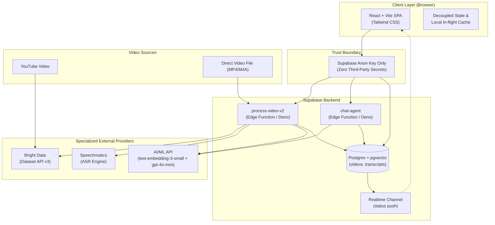
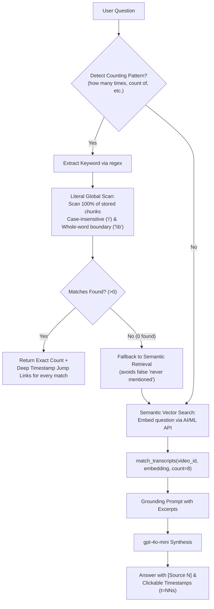

# Askable Architecture & Technical Deep Dive

Askable turns any video into an interactive source you can interrogate in plain language with second-accurate citations. This document explains how the system is structured, how the five core services coordinate, and the trade-offs made across ingestion, retrieval, and security.

---

## 1. High-Level System Topology



Interactive standalone topology view: [`docs/topologia.html`](docs/topologia.html)  
Slide deck presentation: [`docs/presentation.pdf`](docs/presentation.pdf)

---

## 2. The Five Core Services

| Service | Architecture Role | Execution Model |
|---|---|---|
| **Frontend (React + Vite)** | UI, optimistic status updates, persistent multi-video conversation store, timestamp link generation. | Browser client |
| **Supabase Edge Runtime** | Orchestrates video ingestion (`process-video-v2`) and query retrieval (`chat-agent`). Isolates all third-party API credentials. | Serverless Deno |
| **Supabase Postgres + pgvector** | Relational store for videos and timestamped chunks. Vector index (`ivfflat`, cosine distance) for single-video scoped RAG. | Managed database |
| **Bright Data** | Captions retrieval via Dataset API v3. Bypasses YouTube datacenter IP blocks (`LOGIN_REQUIRED`) without headless browser overhead. | Async trigger & snapshot polling |
| **Speechmatics** | High-accuracy Automatic Speech Recognition (ASR) for uploaded MP4 files with millisecond word timestamps. | Direct binary stream & job polling |
| **AI/ML API** | OpenAI-compatible inference gateway powering text embeddings (`text-embedding-3-small`, 1536 dims) and answer generation (`gpt-4o-mini`). Also supports direct OpenAI and Vercel AI Gateway fallback. | HTTPS REST API |

---

## 3. Ingestion Pipelines

Askable provides two distinct, non-blocking ingestion paths:

### Route A: YouTube Captions via Bright Data Dataset API
1. User submits a YouTube URL (`https://www.youtube.com/watch?v=...` or `https://youtu.be/...`).
2. Edge Function inserts a pending record into `videos` and immediately returns `{ video_id, status: 'pending' }` to the client so the UI never blocks.
3. Background task fires Bright Data Dataset API (`gd_lk56epmy2i5g7lzu0k`), triggering snapshot generation.
4. Edge Function polls the snapshot endpoint with exponential backoff.
5. Once captions return, text is normalized, timestamp markers `[m:ss]` are anchored, and chunks are generated.
6. Each chunk is embedded via AI/ML API and committed to Postgres.

> **Why Bright Data instead of direct scraping?** YouTube datacenter IPs systematically throw `LOGIN_REQUIRED` or anti-bot challenge blocks when accessed from cloud edge runtimes (AWS/Supabase). Bright Data completely eliminates IP blocking.

### Route B: Uploaded Video/Audio via Speechmatics
1. User drops a video file (MP4, M4A, etc., up to 20 MB).
2. Edge Function streams the binary buffer directly to Speechmatics ASR API with `enable_entities: true` and auto-language detection.
3. Speechmatics transcribes the audio, generating millisecond-accurate word timings and punctuation.
4. Timed transcript is formatted into timestamped blocks, chunked, embedded via AI/ML API, and committed to Postgres.

---

## 4. Chunking & pgvector Storage Schema

### Database Schema
```sql
create extension if not exists vector;

create table videos (
  id                  uuid primary key default gen_random_uuid(),
  youtube_url         text not null,          -- or upload://<filename>
  title               text,
  status              text not null default 'pending',
  error_message       text,
  speechmatics_job_id text,
  created_at          timestamptz not null default now(),
  updated_at          timestamptz not null default now()
);

create table transcripts (
  id          uuid primary key default gen_random_uuid(),
  video_id    uuid not null references videos(id) on delete cascade,
  chunk_index int not null,
  content     text not null,                  -- carries inline [m:ss] markers
  status      text not null default 'processing',
  embedding   vector(1536),
  created_at  timestamptz not null default now()
);

create index on transcripts using ivfflat (embedding vector_cosine_ops) with (lists = 100);
```

### Sentence-Aware Chunking Strategy
- Transcripts are split along punctuation boundaries (`.`, `!`, `?`) aiming for ~1,000 characters per chunk.
- Every chunk embeds explicit timecodes (e.g. `[12:25]`) into its text content before embedding. This ensures both the vector search model and LLM synthesis preserve temporal grounding.

---

## 5. Dual-Path Interrogation Engine

Standard RAG systems fail on global queries such as *"How many times do they mention X?"* because the top-8 semantic chunks only represent a fraction of the transcript. Askable resolves this with a dual-path engine:



### 1. Literal Exact Mention Counting
- **Regex Specification**: `new RegExp(`\\b${keyword}\\b`, 'gi')`
- **Case Sensitivity**: Case-insensitive (`i` flag). Matches `Government`, `government`, and `GOVERNMENT`.
- **Word Boundaries**: Strict whole-word boundaries (`\b`). Searching for "government" **does not** match plurals ("governments") or partial words/stems ("governing").
- **Exhaustive**: Scans all chunks for that video in Postgres, guaranteed not to drop hits due to top-k truncation.
- **Deep Links**: Extracts inline timestamps `[m:ss]` from every hit chunk and returns direct clickable deep links (`&t=NNs`).

### 2. Semantic Search Fallback
- If the literal regex finds 0 hits, or if the question is conceptual ("How often do they discuss economic intervention?"), the engine automatically falls through to semantic vector retrieval.
- Vector search is strictly scoped to `video_id` via Supabase RPC (`match_transcripts`), eliminating false cross-video contamination.
- Context is assembled with indexed excerpts and passed to `gpt-4o-mini` with strict instructions: answer ONLY using excerpts and cite sources.

---

## 6. Security Architecture & Trust Boundary

### Zero Keys in the Browser
All third-party credentials (`BRIGHTDATA_API_KEY`, `SPEECHMATICS_API_KEY`, `AIML_API_KEY`) live exclusively in Supabase Edge Function environment variables. The browser only receives the public Supabase Anon Key.

### Open Endpoints (`--no-verify-jwt`)
Both Edge Functions (`process-video-v2` and `chat-agent`) are intentionally deployed with `--no-verify-jwt`:
- **Design Decision**: Hackathon and peer review judging requires immediate, frictionless evaluation without requiring judges to register accounts, confirm emails, or navigate authentication walls.
- **Production Hardening Path**: For public deployment, verify JWT via Supabase Auth (`supabase.auth.getUser`), inject a pre-shared header token (`x-askable-key`), or configure Supabase API Gateway rate limiting.

---

## 7. Reliability & Verified Benchmarks

- **Longest Video Tested**: **52 minutes** (*"What Do Hackathon Judges Look For? 5 Live AI App Reviews"* by Joe Holmes, Devpost Learn — [`https://youtu.be/Xh8Ie_VuA_0`](https://youtu.be/Xh8Ie_VuA_0)), alongside **42-minute** (*"State of GPT"* by Andrej Karpathy) and up to 2-hour long recordings via Speechmatics.
- **UI Decoupling**: Ingestion and conversation state exist above the view components in `src/lib/conversations.ts`, persisting across video navigation and background network requests.
- **Built-in Error Boundaries**: Defensively catches rendering issues and provides a one-click return to the instant interactive sandbox.
